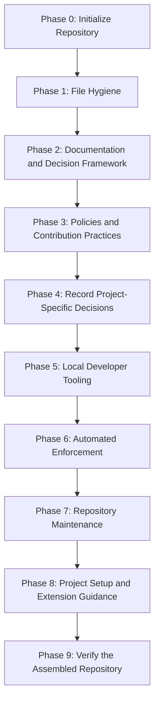

# Milestone 0: Repository Scaffolding

[Docs](../README.md) > [Roadmap](README.md) > Milestone 0

* **Status**: Completed
* **Owner**: Pending assignment; see [Contributing](../../CONTRIBUTING.md).
* **Scope**: Establish the repository foundation and its standards, documentation,
  decisions, tooling, and enforcement.

This milestone establishes the repository foundation. Its phases follow the
dependency order below. Keep this record as the history of the initial scaffolding
and plan subsequent project work from Milestone 1.

## Current Position

Phases 0–9 are Completed. Phase 6 live controls and available workflow cases are
verified, with maintainer-approved follow-ups recorded in the
[verification record](../architecture/phase-6-verification.md#accepted-follow-ups).
Phase 7 implementation PRs #10–#13 are merged and the assembled checkout is
verified. Phase 8 implementation PRs #15–#19 are merged; its project setup path
passed the local checks recorded below. PRs #20 and #21 completed the Phase 8
status update and the Phase 9 test-fixture correction. The assembled foundation
and a representative initialized project passed the Phase 9 checks recorded below.

[ADR-0001](../adr/0001-adopt-google-documentation-style.md) accepts Google
Developer Documentation Style.

[ADR-0002](../adr/0002-secret-management.md) remains Proposed pending a project decision.
[ADR-0004](../adr/0004-release-versioning.md) leaves release versioning open for the
project to select before publication.

[ADR-0003](../adr/0003-enforce-repository-quality-checks.md) accepts the shared
quality-checking approach. Decision approval does not verify live enforcement.

Git history and pull requests record integration into `main`. The
`archive/m0-scaffolding-history` tag preserves the original scaffolding history;
the `chore/scaffold-repository` branch is retired. The
`chore/reference-scaffolding-drafts` branch retains the original draft snapshot.
Reference content does not establish implementation or phase completion.

## Phase 6 Verification

The [verification record](../architecture/phase-6-verification.md) contains the
observed settings, successful runs, title-failure and merge-blocking tests, and
maintainer confirmation of the private reporting fallback. The maintainer accepted
its unobserved live cases as owned follow-ups. Phase 6 is Completed on that basis;
the accepted follow-ups are not recorded as passing tests.

## Dependency Order

Follow this order when introducing the remaining work. Each phase may contain
several small review and commit groups.

This is the working sequence, not a requirement to invent content for every phase.
Introduce supporting requirements before their implementation. A Proposed ADR
comparison does not select an implementation for the project.

## Phases and Deliverables

The numbered phases preserve the original scaffolding dependency order. The work
and file groups below define each phase's scope; a file existing on the reference
branch does not mean its phase is implemented.

Completed means the phase's scoped deliverables have been reviewed, verified, and
committed. It does not by itself assert merge status; Git history and pull requests
record integration into `main`. Paths below identify existing files or planned
deliverables; future paths are not links to implemented content.

| Phase | Status | Work and steps | Relevant files and deliverables |
| :--- | :--- | :--- | :--- |
| **0. Initialize the repository** | Completed | Establish repository identity and license. | Initial `README.md` and `LICENSE`. |
| **1. Establish file hygiene** | Completed | Set editor defaults, Git file handling, and exclusions. | `.editorconfig`, `.gitattributes`, `.gitignore`. |
| **2. Establish the documentation and decision framework** | Completed | Define the repository's purpose; establish documentation ownership and navigation; define how decisions are proposed and recorded. | Narrowed `README.md`, `docs/README.md`, `docs/standards/documentation.md`, standards index, ADR index and template, and `docs/standards/architecture-decisions.md`. ADR-0001 records the approved Google documentation style decision. The roadmap records the scaffolding plan. |
| **3. Establish repository policies and contribution practices** | Completed | Review Git conventions, dependency standards, community expectations, security reporting, contributor guidance, and agent instructions. Add issue and PR templates alongside the practices they support. Define maintainer ownership, CODEOWNERS adoption guidance, and basic issue triage and label conventions. | `docs/standards/git-workflow.md`, `docs/standards/dependencies.md`, `CONTRIBUTING.md`, `SECURITY.md`, `CODE_OF_CONDUCT.md`, `AGENTS.md`, `docs/AGENTS.md`, `.github/ISSUE_TEMPLATE/`, `.github/PULL_REQUEST_TEMPLATE.md`, `docs/standards/ownership.md`, `docs/standards/issue-triage.md`, and `.github/CODEOWNERS`. |
| **4. Record project-specific decisions** | Completed | Introduce proposed ADRs containing requirements, options, use cases, trade-offs, and open outcomes. Separate mandatory hygiene from implementation choices. Begin with secrets and review any other decisions the project must own. | Proposed records in `docs/adr/`, starting with ADR-0002. Hold `.env.example` outside the intended baseline unless explicitly approved; a proposed comparison does not select an implementation. |
| **5. Add local developer tooling** | Completed | Implement helpers for established practices, document prerequisites and behavior, and test each helper as introduced. Setup must respect the secrets decision rather than automatically assuming `.env`. | `.githooks/`, `scripts/dev/`, focused helper tests, and an incremental `scripts/README.md`. |
| **6. Add automated enforcement** | Completed | Implement checks for approved standards, add their regression coverage, then connect them to CI. Document actual enforcement and required GitHub settings, including a repository settings checklist for review requirements, required status checks, merge behavior, and force-push protections. | `scripts/ci/`, regression tests, `.github/workflows/`, `.github/dependabot.yml`, `.vale.ini`, vocabulary, CI architecture documentation, and an ADR for the quality-checking approach. |
| **7. Add repository maintenance procedures** | Completed | Define release verification, dependency maintenance, credential-exposure response, and an issue triage procedure based on the Phase 3 conventions. Introduce release notes categories and `.github/release.yml` alongside the release process. Introduce operational scripts and associated tests together. | `docs/runbooks/`, `scripts/ops/`, associated tests, and corresponding architecture updates. |
| **8. Complete project setup and extension guidance** | Completed | Establish a concise root entry point and task-oriented runbooks for repository initialization and GitHub configuration. Audit and reduce repeated identity, contact, and URL customization. Keep reusable standards and procedures project-neutral, preserve attribution and historical authorship, and distinguish source verification evidence from verification of a new repository. Link to existing standards and ADRs for explanations and deferred choices. Introduce extension or troubleshooting material only for concrete tasks; reconsider the reference guides and application tutorial instead of adopting their structure automatically. | Repository-initialization and GitHub-settings runbooks, updated navigation and root README, scoped portability changes, and the preview-based one-time initialization helper. |
| **9. Verify the assembled repository** | Completed | Check a clean checkout and a representative initialized project, confirm navigation and automation, and prepare the remaining changes for review and merge. | The resulting committed repository, not the surrounding drafts. Verify the full foundation and its project-initialization path. |

### Phase Boundaries

- The ADR framework belongs to Phase 2. Project-specific comparisons begin in
  Phase 4 and leave their outcomes open for the project to decide.
- Written policies belong to Phase 3; local helpers and automated checks follow
  in Phases 5 and 6. Reference files do not satisfy implementation dependencies.
- Introduce tests with the functionality they verify. Maintenance helpers and
  their tests belong to Phase 7.
- Application setup and extension guidance belong to Phase 8. The reference
  application tutorial remains subject to review rather than automatic adoption.

## Next Milestone

Use the [roadmap index](README.md#continuing-with-milestone-1) to plan Milestone 1
for the project's next goal. Keep Proposed ADR outcomes open until the project has
requirements and a decision maker. Retain the Phase 6 accepted follow-ups as
maintainer-owned verification work when their events or contributors become available.

### Phase 8 Review Groups

1. **Portability audit**: Identify active project identity, reporting contacts,
   ownership mappings, repository URLs, and source-specific verification records.
   Reduce repeated edits while preserving copyright notices and historical ADR
   authorship. Keep ongoing standards and procedures usable after initialization.
2. **Repository initialization**: Add a runbook that covers creating the project,
   setting its identity and contacts, enabling local tooling, and verifying the
   resulting repository. Keep contribution to this foundation separate from
   starting a new project. Leave Proposed choices open until needed.
3. **GitHub configuration**: Add a runbook for inspecting existing settings,
   activating workflows and labels, choosing eligible review owners, applying
   repository protections, and verifying the result. Link to the existing
   [settings checklist](../architecture/repository-settings.md) for requirements
   and to official provider documentation for supported configuration steps.
4. **Navigation and extension**: Keep the root README short, with clear paths for
   project setup, routine maintenance, standards, decisions, and contribution.
   Put troubleshooting with the relevant procedure. Add an extension runbook only
   when there is a concrete recurring task; do not add an application tutorial by
   default.
5. **Initialization cleanup**: Provide a one-time helper for the source-only
   material identified by the audit. Preview the Milestone 0 replacement, exact
   removals, and navigation updates by default; require an explicit apply action.
   Check the repository root, refuse unexpected or modified removal candidates,
   and validate the resulting links before completing the operation. Do not select
   files through
   broad name patterns or a search for the word `template`. Keep authoring
   templates, reusable policies, maintenance tooling, and project work intact.

The intended outcome is a repository that reads as the project's own after the
initialization runbook, README customization, and reviewed cleanup. Active project
identity and contacts must not require a recurring search through all standards
and runbooks. The audit determines which source-specific verification records
and one-time setup instructions can be removed or replaced. Replace the
source-specific Milestone 0 history with a concise record of the project's own
starting practices. The source repository's verification does not prove the new
repository's settings.

The cleanup helper and its explicit removal list are implemented. It previews
changes by default. It replaces Milestone 0 and removes source-only files only
after an explicit apply action and safety checks. Existing architecture references
own implementation explanations; runbooks own execution steps without duplicating
requirements.

### Phase 8 Verification

- **Integration**: PRs #15–#19 are merged into `main`. The resulting Phase 8
  source commit is `7d2f868`.
- **Merged-source checks**: On 2026-11-10, the local repository suite passed at
  `7d2f868`: 28 developer-tooling tests, 63 CI-check tests, and 13 operational
  tests. Five CI-check tests skipped real-tool integration because their pinned
  external tools were not installed locally; hosted checks remain separate.
- **Representative project setup**: A fresh one-commit repository made from that
  source commit, with an example project origin, completed the helper's configure
  and finish preview and apply paths. The setup changed the project README and
  ownership, updated repository links and contacts, and removed the four
  source-only files, including the Phase 6 verification record. Link, documentation,
  secret, repository, and whitespace checks passed on the resulting project copy.
  This local project copy does not verify live GitHub settings for a new project.

### Checkpoint Before Phase 7

PRs #1–#8 and the Phase 6 verification PR are merged. The verification record
contains observed results and accepted maintainer-owned follow-ups. Continue
Phase 7 on focused topic branches from `main`, using the review process below.

### Phase 7 Progress

The [runbook framework](../runbooks/README.md),
[authoring template](../runbooks/template.md), and
[issue-triage procedure](../runbooks/issue-triage.md) establish the first maintenance
group. The [dependency-maintenance procedure](../runbooks/dependency-maintenance.md)
connects the dependency standard to manual and automated update review. The
[release process](../runbooks/release-process.md) and its verification helper are
established with the Proposed versioning decision and operational regression
coverage. The [credential-exposure response](../runbooks/secret-rotation.md)
completes the planned incident procedure. Release-note configuration and label
conventions are implemented. Procedures link to canonical standards and include verification and
recovery steps. They do not assert that platform settings are already configured
in every repository.

### Phase 7 Verification

- **Local verification**: All 96 regression tests passed with the pinned tools,
  including 13 operational tests. Link, documentation structure, prose, shell,
  workflow, credential, and whitespace checks passed for the reviewed groups.
- **Labels**: `dependencies`, `github-actions`, and `breaking-change` were created
  and their descriptions verified in the target repository.
- **Final release-note preview**: On 2026-11-10, GitHub's generate-notes API
  confirmed use of `.github/release.yml` from merged `main` at `7adbb0d`.
  Dependency updates, Enhancements, and Documentation contained the expected merged
  PRs, including PR #13 under Dependency updates. Eight local classification
  scenarios covered overlapping and unmatched labels. The preview created no tag
  or release; categories without representative merged PRs remain locally verified.
- **Final live release readiness**: On 2026-11-10, the helper passed on clean
  merged `main` at `7adbb0d`, including all 96 local tests and the exact-commit
  [push CI run](https://github.com/austinperrin/scaffolding/actions/runs/42828334015).
  The candidate `phase-7-readiness-check` was not created as a tag or release.
  ADR-0004 remains Proposed; readiness did not select a versioning scheme.
- **Integration**: PRs #10–#13 are merged. The clean assembled Phase 7 checkout,
  its hosted CI, live readiness helper, and generated-note configuration are
  verified. Phase 7 was Completed; Phase 8 was Pending for scope review at that
  checkpoint.

## Phase 9 Verification

- **Merged foundation**: PRs #20 and #21 are merged. On 2026-11-10, the clean
  `main` checkout at `d02ab47` passed the local repository suite: 28 developer
  tests, 63 CI tests, and 13 operational tests. Five real-tool integration cases
  skipped locally because their pinned external tools were not installed.
- **Hosted automation**: The merged tree at `d02ab47` matches the tree of PR #21's
  tested head commit. Its [hosted run](https://github.com/austinperrin/scaffolding/actions/runs/42947659844)
  passed the Linux, macOS, and external-check jobs. The Phase 6
  [verification record](../architecture/phase-6-verification.md) retains the live
  repository settings and remaining unobserved cases.
- **Project initialization**: A fresh one-commit project repository made from
  `d02ab47` passed the configure and cleanup preview and apply paths. The check
  replaced the README and owner mappings, updated repository links and reporting
  contacts, enabled the local commit hook, and removed the four source-only files.
  The resulting project copy passed the full local suite, link, documentation,
  secret, repository, and whitespace checks. Its Milestone 0 record and reusable
  policies, ADRs, runbooks, and authoring templates remained available.
- **Navigation and limits**: The root README's paths to project setup, GitHub
  configuration, standards, maintenance, decisions, and the roadmap were reviewed;
  source and project-copy link and documentation checks passed. The project copy
  was local, so it did not establish live settings or hosted runs for a newly
  created GitHub repository. Those must be verified when a project is created.

## Review and Commit Process

1. Select a focused group whose prerequisites are already committed or will be
   introduced in the same group.
2. Bring in only the relevant reference material and adapt it to the current phase.
3. Review the files together and revise them until approved.
4. Verify the proposed commit snapshot, including links and dependencies. Files
   stored only on the reference branch do not satisfy a working-branch dependency.
5. Commit and push the approved group, then update this milestone's status and
   completion evidence as appropriate.

Update this document when phases advance, dependencies change, or completed work
is merged. Keep detailed requirements in their canonical standards and link to
them rather than repeating their instructions here.

## Milestone Completion

Milestone 0 is Completed after its required phases were reviewed, verified, and
merged into the repository's `main` branch. Proposed project decisions remain
open; completing a comparison does not select its outcome.

The completed milestone records the foundation for subsequent project work.
Use the [roadmap index](README.md#continuing-with-milestone-1) to add the next
milestone and any dependencies on unfinished scaffolding work.

## Related Documents

- [Roadmap index](README.md) - Milestone status and project continuation.
- [Documentation hub](../README.md) - Documentation categories and references.
- [Documentation standards](../standards/documentation.md) - Ownership and navigation conventions.
- [Architecture Decision Records (ADRs) index](../adr/README.md) - Decisions and their current status.
