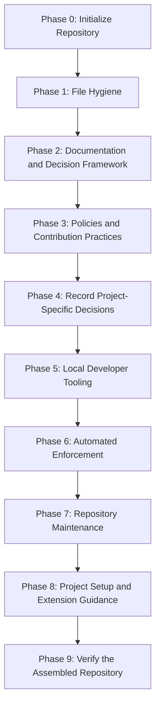

# Milestone 0: Repository Scaffolding

[Docs](../README.md) > [Roadmap](README.md) > Milestone 0

* **Status**: In progress
* **Owner**: Pending assignment; link to the contributors document once introduced.
* **Scope**: Establish the repository foundation and its standards, documentation,
  decisions, tooling, and enforcement.

This milestone establishes the repository foundation. Its phases follow the
dependency order below. Keep this record as the history of the initial scaffolding
and plan subsequent project work from Milestone 1.

## Current Position

The `chore/scaffold-repository` branch has completed Phases 1 and 2, with the
completion commits recorded below. **Phase 3: Repository Policies and Contribution
Practices** is complete on the scaffolding branch. The Git workflow standard is committed at `99053d0`;
the dependency management policy is committed at `4e00771`. Security reporting
and community expectations are committed at `fc08ce4`. Contributor guidance and
related-document navigation conventions are committed at `245a543`; agent
instructions are committed at `408c846`. Issue forms and a pull request template
are committed at `596e243`. Ownership and issue triage standards, a commented
CODEOWNERS scaffold, and external platform guidance in the standards index are
committed at `fb545fa`. Phase 4 is committed at `30d34fd`; ADR-0002 remains Proposed for adopters.
Phase 5 setup and commit-hook tooling are committed at `2690212`. The ADR
generator is committed at `a6aa791`. The cleanup helper and its regression tests are committed at `803b851`. Phase 5
is complete on the scaffolding branch. Phase 6 begins with ADR-0003, accepted at `7a6d5f3`. Local documentation checks,
regression tests, and CI architecture are committed at `34dcb16`. Credential-filename
and repository-configuration checks are committed at `30e765e`. The suite runner
and orchestration regression tests are established with this change.
CI enforcement remains pending.

| Branch | Committed state |
| :--- | :--- |
| `main` and `origin/main` | Phase 0: initial README and license at `28e9950` |
| `chore/scaffold-repository` and its remote branch | Phase 1 at `59f58a1`; Phase 2 at `a86081f`, with the roadmap at `91bc7f4`; Git workflow work within Phase 3 at `99053d0`. These changes are not yet merged into `main`. |
| `chore/reference-scaffolding-drafts` and its remote branch | Reference snapshot at `6f09186`; its contents are drafts, not completed scaffolding phases |

The committed [ADR-0001](../adr/0001-adopt-google-documentation-style.md) accepts
Google Developer Documentation Style. [ADR-0002](../adr/0002-secret-management.md)
provides a secrets comparison for the project maintainers and remains Proposed. Vale and
other automation are pending Phase 6.

## Dependency Order

Follow this order when introducing the remaining work. Each phase may contain
several small review and commit groups.

This is the working sequence, not a requirement to invent content for every phase.
Earlier groups can introduce supporting material for later work, as the secrets
comparison in Phase 2 does. That does not complete the later phase or select an
implementation for the project.

## Phases and Deliverables

The numbered phases preserve the original scaffolding dependency order. The work
and file groups below define each phase's scope; a file existing on the reference
branch does not mean its phase is implemented.

Completion means reviewed and committed on the scaffolding branch. The branch
table above separately identifies what has reached `main`. Paths below identify
existing files or planned deliverables; future paths are not links to implemented content.

| Phase | Status | Work and steps | Relevant files and deliverables |
| :--- | :--- | :--- | :--- |
| **0. Initialize the repository** | Complete on `main` | Establish repository identity and license. | Initial `README.md` and `LICENSE`. |
| **1. Establish file hygiene** | Complete on scaffolding branch | Set editor defaults, Git file handling, and exclusions. | `.editorconfig`, `.gitattributes`, `.gitignore`. |
| **2. Establish the documentation and decision framework** | Complete on scaffolding branch | Define the repository's purpose; establish documentation ownership and navigation; define how decisions are proposed and recorded. | Narrowed `README.md`, `docs/README.md`, `docs/standards/documentation.md`, standards index, ADR index and template, and `docs/standards/architecture-decisions.md`. ADR-0001 records the approved Google documentation style decision. The roadmap records the scaffolding plan. |
| **3. Establish repository policies and contribution practices** | Complete on scaffolding branch | Review Git conventions, dependency standards, community expectations, security reporting, contributor guidance, and agent instructions. Add issue and PR templates alongside the practices they support. Define maintainer ownership, CODEOWNERS adoption guidance, and basic issue triage and label conventions. | `docs/standards/git-workflow.md`, `docs/standards/dependencies.md`, `CONTRIBUTING.md`, `SECURITY.md`, `CODE_OF_CONDUCT.md`, `AGENTS.md`, `docs/AGENTS.md`, `.github/ISSUE_TEMPLATE/`, `.github/PULL_REQUEST_TEMPLATE.md`, `docs/standards/ownership.md`, `docs/standards/issue-triage.md`, and `.github/CODEOWNERS`. |
| **4. Record project-specific decisions** | Complete on scaffolding branch; secrets outcome remains Proposed | Introduce proposed ADRs containing requirements, options, use cases, trade-offs, and open outcomes. Separate mandatory hygiene from implementation choices. Begin with secrets and review any other decisions the project must own. | Proposed records in `docs/adr/`, starting with ADR-0002. Hold `.env.example` outside the intended baseline unless explicitly approved; a proposed comparison does not select an implementation. |
| **5. Add local developer tooling** | Complete on scaffolding branch | Implement helpers for established practices, document prerequisites and behavior, and test each helper as introduced. Setup must respect the secrets decision rather than automatically assuming `.env`. | `.githooks/`, `scripts/dev/`, focused helper tests, and an incremental `scripts/README.md`. |
| **6. Add automated enforcement** | In progress; local suite established | Implement checks for approved standards, add their regression coverage, then connect them to CI. Document actual enforcement and required GitHub settings, including a repository settings checklist for review requirements, required status checks, merge behavior, and force-push protections. | `scripts/ci/`, regression tests, `.github/workflows/`, `.github/dependabot.yml`, `.vale.ini`, vocabulary, CI architecture documentation, and an ADR for the quality-checking approach. |
| **7. Add repository maintenance procedures** | Pending | Define release verification, dependency maintenance, credential-exposure response, and an issue triage procedure based on the Phase 3 conventions. Introduce release notes categories and `.github/release.yml` alongside the release process. Introduce operational scripts and associated tests together. | `docs/runbooks/`, `scripts/ops/`, associated tests, and corresponding architecture updates. |
| **8. Complete project setup and extension guidance** | Pending | Explain how to implement the repository foundation, replace its identity, and handle scaffolding-specific material. Include replacing repository-specific URLs in issue forms, issue chooser contacts, and the pull request template so links and reports target the adopting project. Assign project owners and configure CODEOWNERS with the adopting project's people or teams; verify the repository settings checklist. Provide reference guidance for extending standards as the project grows. Reconsider the application tutorial when reviewing this group. | Getting Started, scaling guidance, troubleshooting, `docs/guides/README.md`, and the completed root README. The reference `docs/guides/building-your-project.md` is material to reconsider, not a committed deliverable. |
| **9. Verify the assembled repository** | Pending | Check a clean checkout and a representative initialized project, confirm navigation and automation, and prepare the scaffolding branch for merge. | The resulting committed repository, not the surrounding drafts. Verify the full foundation and its project-initialization path. |

### Phase Boundaries

- The ADR framework belongs to Phase 2. ADR-0002 was introduced alongside it as
  an open comparison. The Phase 4 review below confirms that no unresolved
  choice is forced by the baseline.
- Written policies belong to Phase 3; their local helpers and automated enforcement
  follow in Phases 5 and 6. Do not introduce an entire future toolchain to satisfy
  a reference document's existing links or claims.
- Introduce tests with the functionality they verify. Release helpers and their
  tests belong to Phase 7, even if the reference test module groups them with CI checks.
- Phase 8 is the implementation and extension guidance group. Application tutorial
  material remains subject to review there; the roadmap does not require adopting it.

## Next Review Group

Evaluate and introduce external linters with pinned versions, configuration,
documented installation and commands, and representative failure checks before
connecting the suite and linters to CI. Keep additions in focused review groups.

### Evaluation Checkpoint Before Phase 7

At the user's request, stop after Phase 6 for an evaluation discussion before
starting any Phase 7 maintenance procedures, release configuration, or operational
scripts. Completing Phase 6 does not authorize crossing this checkpoint.

### Phase 4 Decision Review

- **Secrets**: ADR-0002 provides requirements, three options with use cases and
  trade-offs, an open outcome, and implementation evidence to complete. Its
  decision owner and selected approach remain pending for the adopting project.
- **Baseline independence**: The committed baseline at `fb545fa` includes ignore
  rules for common credential files but no `.env.example`, secret loader, or
  provider integration. Ignore rules do not select an implementation.
- **Application technology and web design**: No application or interface exists
  yet to provide meaningful decision drivers. Defer these ADRs until an adopting
  project has concrete requirements instead of inventing choices now.
- **Quality tooling**: Record the planned quality-checking decision with its
  implementation in Phase 6, where the checks and their consequences can be reviewed.

The Phase 4 review is complete. It confirms the decision framework and open
comparison, without accepting a secrets implementation for adopters.

The contribution templates become available through GitHub after they reach the
default branch; verify their rendered behavior during the assembled-repository
review. Local validation does not confirm GitHub activation.

## Review and Commit Process

1. Select a focused group whose prerequisites are already committed or will be
   introduced in the same group.
2. Bring in only the relevant reference material and adapt it to the current phase.
3. Review the files together and revise them until approved.
4. Verify the proposed commit snapshot, including links and dependencies. Files
   stored only on the reference branch do not satisfy a working-branch dependency.
5. Commit and push the approved group, then update this milestone's status and
   completion evidence as appropriate.

Update this document when phases advance, dependencies change, or completed work
is merged. Keep detailed requirements in their canonical standards and link to
them rather than repeating their instructions here.

## Milestone Completion

Mark Milestone 0 Complete once its required phases have been reviewed, verified,
and merged into the repository's `main` branch. Proposed project decisions can
remain open; completing a comparison does not select its outcome.

The completed milestone records the foundation for subsequent project work.
Use the [roadmap index](README.md#continuing-with-milestone-1) to add the next
milestone and any dependencies on unfinished scaffolding work.

## Related Documents

- [Roadmap index](README.md) - Milestone status and project continuation.
- [Documentation hub](../README.md) - Documentation categories and references.
- [Documentation standards](../standards/documentation.md) - Ownership and navigation conventions.
- [Architecture Decision Records (ADRs) index](../adr/README.md) - Decisions and their current status.
