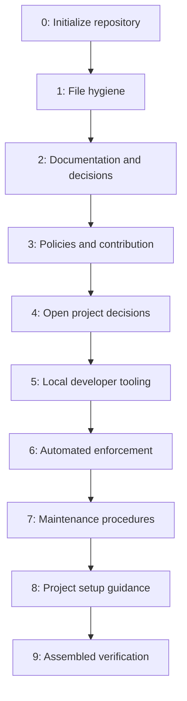

# Milestone 0: Repository Scaffolding

[Docs](../README.md) > [Roadmap](README.md) > Milestone 0

- **Outcome:** Establish and verify the repository's initial policies, documentation,
  decisions, tooling, automation, and project setup path.
- **Owner:** Repository maintainers.
- **Status:** Completed
- **Target:** No committed target was recorded.
- **Actual timing:** See the [roadmap schedule](README.md#schedule) for the
  repository creation and final pull request merge dates.
- **Dependencies:** None; this milestone established the initial repository.

This is the completed delivery record for the scaffold. A project initialized
from it receives a project-owned Milestone 0 record. Plan subsequent work using
the [milestone planning template](milestone-template.md).

## Dependency Order

The phases followed this sequence so each group could build on established
policies and decisions. Each phase could contain several focused pull requests.

## Phase Outcomes

All phases are Completed. The [roadmap schedule](README.md#schedule) owns their
schedule and status; the linked documents own the resulting rules and procedures.

### Phase 0: Initialize Repository

Established repository identity and license.

### Phase 1: File Hygiene

Added editor defaults, Git attributes, and exclusions.

### Phase 2: Documentation and Decisions

Established the documentation hub, writing standard, roadmap, and ADR process;
accepted [ADR-0001](../adr/0001-adopt-google-documentation-style.md).

### Phase 3: Policies and Contribution

Established contribution, security, community, ownership, Git, dependency, and
issue-triage practices with issue and PR templates.

### Phase 4: Open Project Decisions

Recorded project choices such as [secret management](../adr/0002-secret-management.md)
as Proposed ADRs without selecting outcomes.

### Phase 5: Local Developer Tooling

Added local setup, hooks, cleanup helpers, and regression coverage.

### Phase 6: Automated Enforcement

Added repository checks, pinned external tools, CI workflows, dependency updates,
and the [settings checklist](../architecture/repository-settings.md).

### Phase 7: Maintenance Procedures

Added [runbooks](../runbooks/README.md) for issue triage, dependencies, releases,
and credential exposure, with operational tests.

### Phase 8: Project Setup Guidance

Added root navigation, the initialization runbook, the GitHub configuration path,
and the one-time setup helper.

### Phase 9: Assembled Verification

Checked the merged repository and a representative initialized project, including
navigation and automation.

## Completion Evidence

| Area | Reviewed evidence and limits |
| :--- | :--- |
| Live repository controls | The [Phase 6 verification record](../architecture/phase-6-verification.md) records settings, successful jobs, the rejected PR-title case, and maintainer-approved follow-ups. Those follow-ups are assigned for later observation, not recorded as passing. |
| Maintenance procedures | PRs #10–#13 established the runbooks, helper, release-note configuration, and labels. The [Phase 7 push run](https://github.com/austinperrin/scaffolding/actions/runs/42828334015) passed for the reviewed merged commit. No version tag or release was created by the readiness check. |
| Project setup path | PRs #15–#19 introduced and checked the initialization workflow. A representative project copy passed local setup and repository checks; that copy did not verify live GitHub settings. |
| Final foundation | PRs #20–#22 completed the assembled checks and project-ready wording. The clean source checkout passed the local suite; the [final hosted run](https://github.com/austinperrin/scaffolding/actions/runs/43125044915) passed Linux, macOS, and external-check jobs. A fresh project copy passed setup and local checks. Its GitHub controls still require project-specific verification. |

The `archive/m0-scaffolding-history` tag retains the original scaffolding history.
Git history and merged PRs provide the detailed change record.

## Open Decisions and Handoff

[ADR-0002](../adr/0002-secret-management.md) leaves secret storage and delivery
for the project to decide. [ADR-0004](../adr/0004-release-versioning.md) leaves
release versioning open until publication needs are known.
[ADR-0003](../adr/0003-enforce-repository-quality-checks.md) records the accepted
quality-checking approach; live controls still need verification in each new
repository. The Phase 6 record owns its accepted verification follow-ups.

Plan the next project goal using the [milestone planning template](milestone-template.md).
Run the [project initialization](../runbooks/initialize-repository.md) and
[GitHub configuration](../runbooks/configure-github.md) procedures for a new
repository before treating its settings as verified.

## Related Documents

- [Roadmap index](README.md) - Milestone status and project continuation.
- [Milestone planning template](milestone-template.md) - Structure for the next outcome.
- [Phase 6 verification record](../architecture/phase-6-verification.md) - Live source-repository evidence and follow-ups.
- [Architecture Decision Records (ADRs) index](../adr/README.md) - Accepted and Proposed decisions.
