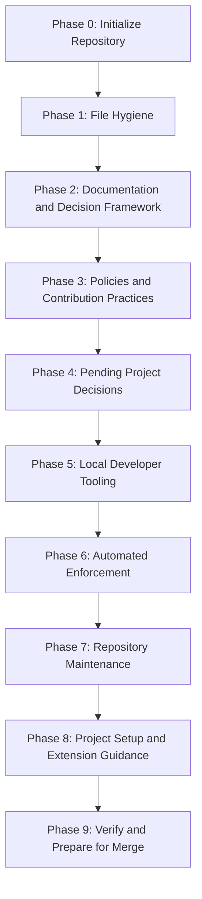

# Milestone 0: Repository Scaffolding

[Docs](../README.md) > [Roadmap](README.md) > Milestone 0

* **Status**: In progress
* **Owner**: Pending assignment; link to the contributors document once introduced.
* **Scope**: Establish the repository foundation and its standards, documentation,
  decisions, tooling, and enforcement.

This milestone establishes the repository foundation. Its phases follow the
dependency order below. Keep this record as the history of the initial scaffolding
and plan subsequent project work from Milestone 1.

## Current Position

The `chore/scaffold-repository` branch has completed Phases 1 and 2, with the
completion commits recorded below. **Phase 3: Repository Policies and Contribution
Practices** is in progress, with the Git workflow standard established.

| Branch | Committed state |
| :--- | :--- |
| `main` and `origin/main` | Phase 0: initial README and license at `28e9950` |
| `chore/scaffold-repository` and its remote branch | Phase 1 at `59f58a1`; Phase 2 at `a86081f`; these changes are not yet merged into `main` |
| `chore/reference-scaffolding-drafts` and its remote branch | Reference snapshot at `6f09186`; its contents are drafts, not completed scaffolding phases |

The committed [ADR-0001](../adr/0001-adopt-google-documentation-style.md) accepts
Google Developer Documentation Style. [ADR-0002](../adr/0002-secret-management.md)
provides a secrets comparison for the project maintainers and remains Proposed. Vale and
other automation are pending Phase 6.

## Dependency Order

Follow this order when introducing the remaining work. Each phase may contain
several small review and commit groups.

This is the working sequence, not a requirement to invent content for every phase.
Earlier groups can introduce supporting material for later work, as the secrets
comparison in Phase 2 does. That does not complete the later phase or select an
implementation for the project.

## Phases and Deliverables

Completion below means reviewed and committed on the scaffolding branch. The
branch table above separately identifies what has reached `main`.

| Phase | Status | Work and completion criteria |
| :--- | :--- | :--- |
| **0. Initialize the repository** | Complete on `main` | Establish the repository, initial README, and license. |
| **1. Establish file hygiene** | Complete on scaffolding branch | Review editor defaults, Git attributes, and ignore rules; commit the three configuration files together. |
| **2. Establish documentation and decision conventions** | Complete on scaffolding branch | Define the project purpose, documentation navigation and conventions, ADR standards and template, and the initial decision records. |
| **3. Establish repository policies and contribution practices** | In progress; Git workflow established | Define Git and dependency policies; review security reporting and community expectations; add contributor guidance, agent instructions, and contribution templates aligned with those policies. |
| **4. Document pending project decisions** | Pending; secrets comparison available | Review the proposed secrets record and identify other decisions the project maintainers must make. Add useful comparisons where needed, with outcomes explicitly open rather than defaulting to a technology or provider. |
| **5. Add local developer tooling** | Pending | Implement and document helpers for established practices. Introduce their verification alongside them. Setup must respect unresolved choices, including secrets storage. |
| **6. Add automated enforcement** | Pending | Implement checks and regression coverage, then connect them to CI. Review Vale rules and blocking levels, dependency updates, and required repository settings. Document only the enforcement actually introduced. |
| **7. Add repository maintenance procedures** | Pending | Introduce release verification, dependency maintenance, and credential-exposure procedures, with the operational tools and tests they require. |
| **8. Complete project setup and extension guidance** | Pending | Explain repository setup, project identity configuration, and any scaffolding-specific cleanup. Provide recommendations for extending the repository's standards as a project grows. |
| **9. Verify the repository foundation** | Pending | Verify a clean committed snapshot and a fresh project setup. Reconcile documentation, checks, and repository settings, then prepare the scaffolding branch for merge. |

## Next Review Group

Review the dependency management policy next, using the reference branch's
`docs/standards/dependencies.md` as a starting point. Adapt its requirements to the
current repository and leave automated updates, auditing, and maintenance procedures
explicitly pending until introduced.

The [Git workflow and commit conventions](../standards/git-workflow.md) are established;
local hooks, automated checks, and contribution templates remain pending.
Other Phase 3 groups cover security reporting, community expectations, contributor
guidance, agent instructions, and contribution templates.

## Review and Commit Process

1. Select a focused group whose prerequisites are already committed or will be
   introduced in the same group.
2. Bring in only the relevant reference material and adapt it to the current phase.
3. Review the files together and revise them until approved.
4. Verify the proposed commit snapshot, including links and dependencies. Files
   stored only on the reference branch do not satisfy a working-branch dependency.
5. Commit and push the approved group, then update this milestone's status and
   completion evidence as appropriate.

Update this document when phases advance, dependencies change, or completed work
is merged. Keep detailed requirements in their canonical standards and link to
them rather than repeating their instructions here.

## Milestone Completion

Mark Milestone 0 Complete once its required phases have been reviewed, verified,
and merged into the repository's `main` branch. Proposed project decisions can
remain open; completing a comparison does not select its outcome.

The completed milestone records the foundation for subsequent project work.
Use the [roadmap index](README.md#continuing-with-milestone-1) to add the next
milestone and any dependencies on unfinished scaffolding work.

## Related Documents

- [Roadmap index](README.md) - Milestone status and project continuation.
- [Documentation hub](../README.md) - Documentation categories and references.
- [Documentation standards](../standards/documentation.md) - Ownership and navigation conventions.
- [Architecture Decision Records (ADRs) index](../adr/README.md) - Decisions and their current status.
