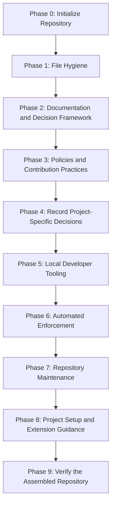

# Milestone 0: Repository Scaffolding

[Docs](../README.md) > [Roadmap](README.md) > Milestone 0

* **Status**: In progress
* **Owner**: Pending assignment; link to the contributors document once introduced.
* **Scope**: Establish the repository foundation and its standards, documentation,
  decisions, tooling, and enforcement.

This milestone establishes the repository foundation. Its phases follow the
dependency order below. Keep this record as the history of the initial scaffolding
and plan subsequent project work from Milestone 1.

## Current Position

Phases 0–5 are Completed in this snapshot. Phase 6 is next.

[ADR-0001](../adr/0001-adopt-google-documentation-style.md) accepts Google
Developer Documentation Style.

[ADR-0002](../adr/0002-secret-management.md) remains Proposed for adopting projects.

Git history and pull requests record integration into `main`. The retained
`chore/scaffold-repository` and `chore/reference-scaffolding-drafts` branches
preserve earlier work for reference; their contents do not establish completion
in this snapshot.

## Dependency Order

Follow this order when introducing the remaining work. Each phase may contain
several small review and commit groups.

This is the working sequence, not a requirement to invent content for every phase.
Introduce supporting requirements before their implementation. A Proposed ADR
comparison does not select an implementation for the adopting project.

## Phases and Deliverables

The numbered phases preserve the original scaffolding dependency order. The work
and file groups below define each phase's scope; a file existing on the reference
branch does not mean its phase is implemented.

Completed means the phase's scoped deliverables have been reviewed, verified, and
committed. It does not by itself assert merge status; Git history and pull requests
record integration into `main`. Paths below identify existing files or planned
deliverables; future paths are not links to implemented content.

| Phase | Status | Work and steps | Relevant files and deliverables |
| :--- | :--- | :--- | :--- |
| **0. Initialize the repository** | Completed | Establish repository identity and license. | Initial `README.md` and `LICENSE`. |
| **1. Establish file hygiene** | Completed | Set editor defaults, Git file handling, and exclusions. | `.editorconfig`, `.gitattributes`, `.gitignore`. |
| **2. Establish the documentation and decision framework** | Completed | Define the repository's purpose; establish documentation ownership and navigation; define how decisions are proposed and recorded. | Narrowed `README.md`, `docs/README.md`, `docs/standards/documentation.md`, standards index, ADR index and template, and `docs/standards/architecture-decisions.md`. ADR-0001 records the approved Google documentation style decision. The roadmap records the scaffolding plan. |
| **3. Establish repository policies and contribution practices** | Completed | Review Git conventions, dependency standards, community expectations, security reporting, contributor guidance, and agent instructions. Add issue and PR templates alongside the practices they support. Define maintainer ownership, CODEOWNERS adoption guidance, and basic issue triage and label conventions. | `docs/standards/git-workflow.md`, `docs/standards/dependencies.md`, `CONTRIBUTING.md`, `SECURITY.md`, `CODE_OF_CONDUCT.md`, `AGENTS.md`, `docs/AGENTS.md`, `.github/ISSUE_TEMPLATE/`, `.github/PULL_REQUEST_TEMPLATE.md`, `docs/standards/ownership.md`, `docs/standards/issue-triage.md`, and `.github/CODEOWNERS`. |
| **4. Record project-specific decisions** | Completed | Introduce proposed ADRs containing requirements, options, use cases, trade-offs, and open outcomes. Separate mandatory hygiene from implementation choices. Begin with secrets and review any other decisions the project must own. | Proposed records in `docs/adr/`, starting with ADR-0002. Hold `.env.example` outside the intended baseline unless explicitly approved; a proposed comparison does not select an implementation. |
| **5. Add local developer tooling** | Completed | Implement helpers for established practices, document prerequisites and behavior, and test each helper as introduced. Setup must respect the secrets decision rather than automatically assuming `.env`. | `.githooks/`, `scripts/dev/`, focused helper tests, and an incremental `scripts/README.md`. |
| **6. Add automated enforcement** | Pending | Implement checks for approved standards, add their regression coverage, then connect them to CI. Document actual enforcement and required GitHub settings, including a repository settings checklist for review requirements, required status checks, merge behavior, and force-push protections. | `scripts/ci/`, regression tests, `.github/workflows/`, `.github/dependabot.yml`, `.vale.ini`, vocabulary, CI architecture documentation, and an ADR for the quality-checking approach. |
| **7. Add repository maintenance procedures** | Pending | Define release verification, dependency maintenance, credential-exposure response, and an issue triage procedure based on the Phase 3 conventions. Introduce release notes categories and `.github/release.yml` alongside the release process. Introduce operational scripts and associated tests together. | `docs/runbooks/`, `scripts/ops/`, associated tests, and corresponding architecture updates. |
| **8. Complete project setup and extension guidance** | Pending | Explain how to implement the repository foundation, replace its identity, and handle scaffolding-specific material. Include replacing repository-specific URLs in issue forms, issue chooser contacts, and the pull request template so links and reports target the adopting project. Assign project owners and configure CODEOWNERS with the adopting project's people or teams; verify the repository settings checklist. Provide reference guidance for extending standards as the project grows. Reconsider the application tutorial when reviewing this group. | Getting Started, scaling guidance, troubleshooting, `docs/guides/README.md`, and the completed root README. The reference `docs/guides/building-your-project.md` is material to reconsider, not a committed deliverable. |
| **9. Verify the assembled repository** | Pending | Check a clean checkout and a representative initialized project, confirm navigation and automation, and prepare the scaffolding branch for merge. | The resulting committed repository, not the surrounding drafts. Verify the full foundation and its project-initialization path. |

### Phase Boundaries

- The ADR framework belongs to Phase 2. Project-specific comparisons begin in
  Phase 4 and leave their outcomes open for the adopting project.
- Written policies belong to Phase 3; local helpers and automated checks follow
  in Phases 5 and 6. Reference files do not satisfy implementation dependencies.
- Introduce tests with the functionality they verify. Maintenance helpers and
  their tests belong to Phase 7.
- Application setup and extension guidance belong to Phase 8. The reference
  application tutorial remains subject to review rather than automatic adoption.

## Next Review Group

Introduce the quality-checking decision and automated enforcement in Phase 6.
Include regression tests with each check and distinguish local verification from
live CI and repository settings.

### Checkpoint Before Phase 7

Before starting Phase 7, review the existing work through separate phase branches
and pull requests in dependency order. Keep every phase's roadmap accurate for
its own contents, preserve the original scaffolding history, and resolve live CI
and repository settings verification as their prerequisites become available.
Phase pull requests require review; their creation does not authorize merging or
starting Phase 7.

## Review and Commit Process

1. Select a focused group whose prerequisites are already committed or will be
   introduced in the same group.
2. Bring in only the relevant reference material and adapt it to the current phase.
3. Review the files together and revise them until approved.
4. Verify the proposed commit snapshot, including links and dependencies. Files
   stored only on the reference branch do not satisfy a working-branch dependency.
5. Commit and push the approved group, then update this milestone's status and
   completion evidence as appropriate.

Update this document when phases advance, dependencies change, or completed work
is merged. Keep detailed requirements in their canonical standards and link to
them rather than repeating their instructions here.

## Milestone Completion

Mark Milestone 0 Completed once its required phases have been reviewed, verified,
and merged into the repository's `main` branch. Proposed project decisions can
remain open; completing a comparison does not select its outcome.

The completed milestone records the foundation for subsequent project work.
Use the [roadmap index](README.md#continuing-with-milestone-1) to add the next
milestone and any dependencies on unfinished scaffolding work.

## Related Documents

- [Roadmap index](README.md) - Milestone status and project continuation.
- [Documentation hub](../README.md) - Documentation categories and references.
- [Documentation standards](../standards/documentation.md) - Ownership and navigation conventions.
- [Architecture Decision Records (ADRs) index](../adr/README.md) - Decisions and their current status.
