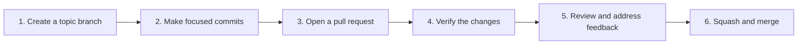

# Git Workflow & Commit Standards

[Docs](../README.md) > [Standards](README.md) > Git Workflow

This repository follows **GitHub Flow** for branching and collaboration and
**Conventional Commits v1.0.0** for commit messages and pull request titles.
This document defines those conventions and the process for reviewing and merging changes.

---

## Branching Strategy (GitHub Flow)

Use the branch-based [GitHub Flow](https://docs.github.com/en/get-started/using-github/github-flow) model:

1. Keep `main` stable and reviewed. Direct commits to `main` are prohibited.
2. Develop changes on a dedicated topic branch and submit them through a pull request.
3. Keep each commit focused on one complete change. Include the files and documentation
   it requires; reference-branch drafts do not satisfy a dependency.
4. Keep unrelated work on separate branches. Delete finished topic branches after
   merging unless they are intentionally retained as references.

### Branch Naming Conventions
Use descriptive, lower-case branch names prefixed with the category of change.
Common prefixes include:

| Prefix | Purpose | Example |
| :--- | :--- | :--- |
| `feat/` | New features or enhancements | `feat/user-authentication` |
| `fix/` | Bug fixes | `fix/null-pointer-exception` |
| `docs/` | Documentation improvements | `docs/update-architecture-overview` |
| `refactor/` | Code refactoring without behavior changes | `refactor/simplify-router` |
| `chore/` | Tooling, dependencies, or maintenance | `chore/bump-actions-versions` |

---

## Commit Standards (Conventional Commits v1.0.0)

Use [Conventional Commits v1.0.0](https://www.conventionalcommits.org/en/v1.0.0/)
for commit messages and pull request titles. The allowed types below are repository
policy. Verification is currently manual; the [enforcement status](#enforcement-status)
separates this policy from tooling that has not yet been introduced.

### Commit Format
```text
<type>(<optional scope>): <description>

[optional body]

[optional footer(s)]
```

The scope is optional. When present, put it in parentheses after the type, as in
`docs(adr): clarify decision ownership`. Use a short description that explains
the change; add a body when the reason or trade-off needs more context.

### Allowed Types

| Type | When to use |
| :--- | :--- |
| `feat` | New functionality or enhancements |
| `fix` | A bug fix |
| `docs` | Documentation changes |
| `style` | Formatting changes that do not affect behavior |
| `refactor` | A structural change that neither fixes a bug nor adds a feature |
| `perf` | A performance improvement |
| `test` | Added or corrected tests |
| `build` | Build system or dependency changes |
| `ci` | Continuous integration configuration or scripts |
| `chore` | Repository housekeeping or maintenance |
| `revert` | Reversal of an earlier change |

Release versioning and automation will be documented with the release process.
The commit type table does not assign automatic version increments to every type.

### Breaking Changes
Indicate breaking changes with an exclamation mark before the colon (`!`) or a `BREAKING CHANGE:` footer:
```text
feat(config)!: change configuration lookup order
```

A breaking change can use any allowed type. When the title alone does not explain
the impact, include a `BREAKING CHANGE:` footer describing what consumers must change.

### Good vs Bad Commit Examples

| Status | Commit Message | Rationale |
| :--- | :--- | :--- |
| Good | `feat(auth): add OAuth2 Google login flow` | Clear type, scope, and imperative description. |
| Good | `fix: resolve crash when user email is undefined` | Explains what bug was resolved. |
| Good | `docs: add troubleshooting steps for Windows line endings` | Concise and informative. |
| Bad | `fixed bug` | Missing type; doesn't describe what was fixed. |
| Bad | `wip` | Never commit incomplete work without a description. |
| Bad | `Update README.md` | Missing conventional type prefix. |

---

## Pull Request Lifecycle



### PR Requirements

1. **Semantic title**: Use the Conventional Commits format, such as
   `docs: establish repository standards`.
2. **Clear description**: Explain the problem, resulting behavior, and verification.
   Link related issues or decisions when applicable. Use the
   [pull request template](../../.github/PULL_REQUEST_TEMPLATE.md) to record these details.
3. **Verification**: Review the proposed commit contents and run checks applicable
   to the change. All configured required checks must pass before merging. Until
   automation is introduced, verify the applicable standards manually and record
   what was checked; do not describe absent checks as passing.
4. **Review**: Resolve feedback and obtain the approval required for the change.
   Keep the review focused on the files actually included in the pull request.
   Use the [ownership standard](ownership.md) to identify review responsibilities.
5. **Squash and merge**: Use the reviewed pull request title as the squash commit
   title. GitHub settings that enforce this workflow are separate from the written
   policy and must be configured and verified when introduced.

## Enforcement Status

Follow the [external platform guidance](README.md#external-platform-guidance)
when introducing platform configuration or repository settings.

These conventions define the intended workflow. Writing them does not install
hooks, create workflows, or configure GitHub branch protection.

| Area | Current state | Planned follow-up |
| :--- | :--- | :--- |
| Commit-message format | Local subject validation when the hook is enabled; manual review of full messages | See the [script reference](../../scripts/README.md) for activation and verification |
| Pull request title | Manual review and metadata workflow definition; live verification pending | Verify activation and required settings through the [checks reference](../architecture/ci-cd.md#pull-request-titles) |
| Pull request description | Pull request template and manual review | Review template prompts when the contribution process changes |
| Repository checks | Local suite and core CI definition; live verification pending | See the [checks reference](../architecture/ci-cd.md) for coverage and activation |
| Merge and review settings | Not yet documented or verified by this scaffolding work | Document and verify repository settings with the corresponding automation and setup work |

The [Milestone 0 roadmap](../roadmap/milestone-0-repository-scaffolding.md)
tracks those follow-up groups. New enforcement must implement this standard;
update the standard and its related tooling together when policy changes.

---

## Related Documents

* [Standards index](README.md) - Canonical repository conventions.
* [Documentation standards](documentation.md) - Writing, formatting, and navigation rules.
* [Architecture Decision Record (ADR) standards](architecture-decisions.md) - Recording significant decisions and their rationale.
* [Milestone 0 roadmap](../roadmap/milestone-0-repository-scaffolding.md) - Scaffolding progress and dependencies.
